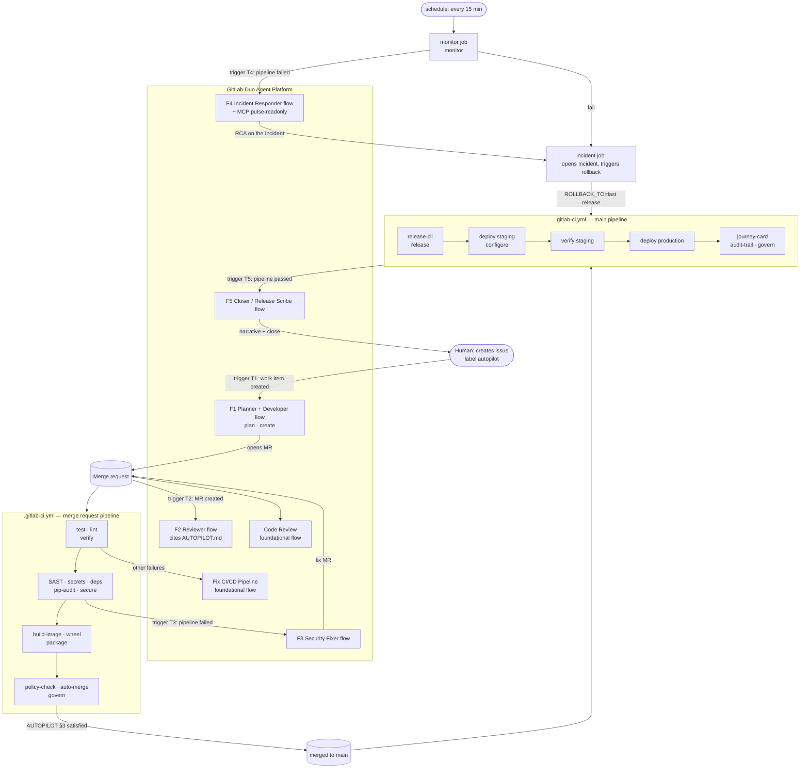

# Autopilot — one issue in, production out

**Code generation is solved. Autopilot takes over everything after the code.**
You create one GitLab issue with the label `autopilot`. Agents plan it, build
it, review it against a written policy, let the scanners judge it, fix what the
scanners find, merge it, package it, release it, promote it from staging to
production, watch it in production, roll it back if it breaks, and write the
story back on your issue. Nine DevSecOps stages, zero humans in the loop.

Built for the GitLab **Life After Code** hackathon (Path A · Start Fresh ·
Hands-off). Everything in this repository was created after 2026-10-05.
License: [MIT](LICENSE).

**What runs today, verifiably, in the history project:** the deterministic
layer — a 12-stage GitLab CI pipeline with the policy engine (`AUTOPILOT.md`
enforced by `scripts/policy.py`), scanners, registries, `release-cli`
releases, staging → production on Render, a scheduled monitor that opens
incidents and triggers rollbacks. Three merge requests (!1–!3) were taken
from "opened" to "merged and released" by that layer with no human click
after the issue; the actors GitLab recorded are a project bot (`scripts/demo.py`)
and CI jobs, and the notes say so.

**What the GitLab Duo Agent Platform adds, in the hackathon project:** the
reasoning layer — 5 custom flows, 4 custom agents, 5 triggers and a read-only
MCP server, defined in `.gitlab/duo/` and registered in the showcase project's
Agent Platform (plan/create by the Planner + Developer flow, policy review by
the Reviewer flow, security fixes, incident RCA, the narrative journey card).
Session links are added to the table below as each flow runs for real; until a
row has a session link, treat that flow as *designed and registered*, not as
*executed*.

> **Hackathon project (judged, Duo Agent Platform):** https://gitlab.com/gitlab-ai-hackathon/transcend-october-2026/43190989/showcase — flows, agents, triggers, AI > Sessions, and the mirrored pipeline.
> **History project (same code, where the pipeline operated for real):** https://gitlab.com/hanwg666/gitlab-autopilot — merge requests !1–!3, releases v0.1.0–v0.1.2, environments on Render, incidents and rollbacks.
> Demo video: `<YOUTUBE_URL>` *(added at submission)*. Both projects receive every commit through one GitHub Actions mirror (`.github/workflows/mirror-to-gitlab.yml`).

## The application under Autopilot: `pulse`

`pulse` is a deliberately small but real service: a FastAPI site-health
monitor. Give it URLs, it probes them on a schedule, stores results in SQLite,
and serves a JSON API, an HTML status page and Prometheus `/metrics`. It has
tests, pinned dependencies, a container image, a wheel, and two deployable
environments — so every lifecycle stage has something genuine to act on. It
also probes other sites while GitLab monitors *it*, which is the kind of loop
this hackathon is about.

```
GET /livez (liveness)  GET /healthz (readiness)  GET /version  GET /metrics  GET /  (status page)
GET /api/sites POST /api/sites DELETE /api/sites/{id}
POST /api/check  GET /api/checks?site_id=&limit=  GET /api/summary
```

## Architecture



Two layers, on purpose:

- **Deterministic layer (CI):** everything that must be exact — scanners,
  builds, the policy gate, the merge call, the release, the deployments, the
  monitor, the incident, the rollback trigger — is a CI job with a script in
  `scripts/`. It runs even when no agent is listening.
- **Reasoning layer (Duo):** everything that needs judgement — planning,
  coding, policy review, choosing a security fix, root-cause analysis, writing
  the story — is a flow. Flows start from GitLab triggers; CI hands off to them
  when a trigger cannot fire (triggers need a human actor).

## The nine stages, and where to see each one

| stage | what Autopilot does | evidence |
|---|---|---|
| **plan** | Planner agent reads the issue, posts a numbered plan citing AUTOPILOT.md | the issue's notes; AI > Sessions |
| **create** | Developer step branches, codes, tests, opens the MR with `Closes #n` | the MR; its commits |
| **verify** | `test` (pytest + coverage + JUnit), `lint` (ruff → Code Quality report), `verify-staging` | MR widget: tests, coverage, code quality |
| **package** | `build-image` → Container Registry; `build-wheel` → PyPI Package Registry | Deploy > Container Registry, Package Registry |
| **secure** | SAST + Secret Detection (GitLab templates, run on every MR and on `main`) and **`pip-audit`** (fails the pipeline on any known vulnerability — this is the scanner that blocked MR !3). Dependency Scanning and Container Scanning are included from the GitLab templates but **self-skip on the Free tier** (they show as allowed-to-fail/skipped; Ultimate only). Failures → Security Fixer flow (Duo) or a scripted fix MR | MR security widget; red `pip-audit` job on MR !3; fix MRs labelled `security-fix` |
| **release** | `release-cli` cuts `vX.Y.Z` with generated notes and asset links when the version changes | Deploy > Releases |
| **configure** | Environments `staging` → `production` on free Render web services (deploy by commit), `resource_group`s, rollback job | Operate > Environments (deployment history) |
| **monitor** | scheduled `monitor` job probes `/healthz` and `/version`; red → `incident` job opens a GitLab Incident and triggers rollback; Incident Responder flow writes the RCA | Monitor > Incidents; the rollback pipeline (`ROLLBACK_TO`) |
| **govern** | `policy-check` enforces AUTOPILOT.md on every MR; `auto-merge` cites the rules; `audit-trail` artifact; MR approval rule; GitLab audit events; journey card on the issue | MR notes; Secure > Audit events; the journey card |

## Judges: how to verify in 5 minutes

Everything below is a page in this project; nothing needs to be run locally.

| minute | open | what you should see |
|---|---|---|
| 0 | [AI > Sessions](https://gitlab.com/gitlab-ai-hackathon/transcend-october-2026/43190989/showcase/-/automate/agent_sessions) · [AI > Flows](https://gitlab.com/gitlab-ai-hackathon/transcend-october-2026/43190989/showcase/-/automate/flows) · [AI > Agents](https://gitlab.com/gitlab-ai-hackathon/transcend-october-2026/43190989/showcase/-/automate/agents) in the **hackathon project** | the 5 custom flows and 4 custom agents registered in the Agent Platform, their triggers, and the real sessions (issue → Planner/Developer → MR, MR → Reviewer, pipeline → Security Fixer / Incident Responder / Closer). The same definitions are versioned in `.gitlab/duo/`. *(paths as the UI shows them; see `.gitlab/duo/triggers.md`)* |
| 1 | [Pipelines](https://gitlab.com/hanwg666/gitlab-autopilot/-/pipelines) → the latest `main` pipeline | 12 stages left to right: `version` → `test` `lint` → `semgrep-sast` `secret_detection` `pip-audit` → `build-image` → `container_scanning` `build-wheel` → `release` → `deploy-staging` → `verify-staging` → `deploy-production` → `journey-card` `audit-trail` → `demo:*` (manual). Every job is green; click any for its log. |
| 2 | [Releases](https://gitlab.com/hanwg666/gitlab-autopilot/-/releases) · [Container Registry](https://gitlab.com/hanwg666/gitlab-autopilot/container_registry) · [Package Registry](https://gitlab.com/hanwg666/gitlab-autopilot/-/packages) | `v0.1.0`, `v0.1.1` cut by `release-cli` with generated notes and asset links; the image tagged by commit SHA, `latest` and `vX.Y.Z`; the `pulse-monitor` wheel per version. |
| 3 | [Environments](https://gitlab.com/hanwg666/gitlab-autopilot/-/environments) | `staging` and `production` with deployment history (dry-run until `RENDER_API_KEY` is present, then live `onrender.com` URLs). |
| 3 | [Merge requests (all)](https://gitlab.com/hanwg666/gitlab-autopilot/-/merge_requests?scope=all&state=all&label_name[]=autopilot) | each `autopilot` MR carries the **policy-check** note (rules §1.1 §2.1 §2.2 §3.4 §3.5 with pass/fail), the **auto-merge** note ("Merging when this pipeline succeeds", §3.2 §3.3), and the labels `autopilot::approved` / `autopilot::needs-human`. The `security-fix` MR shows the red `pip-audit` run and the fixing commit. |
| 4 | [Issues](https://gitlab.com/hanwg666/gitlab-autopilot/-/issues?scope=all&state=all&label_name[]=autopilot) · [Incident #3](https://gitlab.com/hanwg666/gitlab-autopilot/-/issues/3) · [monitor pipeline 2933042883](https://gitlab.com/hanwg666/gitlab-autopilot/-/pipelines/2933042883) | issue #1 closed with its journey card (the first card over-credited Duo flows; the corrected card is the later note). Incident #3 timeline, honestly: `demo:chaos-on` degraded `/healthz` on the live production service (07:10Z) → scheduled `monitor` red after 5 attempts → `incident` job opened #3, cleared the chaos switch on the service (production healthy again at 07:14Z) and triggered the rollback to `v0.1.1`. The first rollback attempt failed (`ROLLBACK_PIPELINE_NOTE`); see the rollback pipeline linked in the incident notes for the completed run. |
| 4 | [`AUTOPILOT.md`](https://gitlab.com/hanwg666/gitlab-autopilot/-/blob/main/AUTOPILOT.md) · [`scripts/policy.py`](https://gitlab.com/hanwg666/gitlab-autopilot/-/blob/main/scripts/policy.py) | the policy in prose and in the YAML block the CI job enforces; every agent/script note ends with `autopilot: rules=[…]` pointing back here. |
| 5 | [`.gitlab/duo/`](https://gitlab.com/hanwg666/gitlab-autopilot/-/tree/main/.gitlab/duo) · AI > Flows / Agents / Triggers / Sessions | the 5 flow definitions, 4 agents, trigger matrix, `mcp.json`, `agent-config.yml`; the same objects in the UI and their sessions once the group has Duo Agent Platform enabled. |
| +1 | the manual **`demo:*` jobs** on the latest `main` pipeline | play `demo:mr` (hands-off merge + release), `demo:security` / `demo:security-fix` (security gate), `demo:chaos-on` / `demo:chaos-off` (incident + rollback) yourself — they only need the project's `AUTOPILOT_TOKEN` variable; `DEMO.md` has the timings. |

Audit trail: [Secure > Audit events](https://gitlab.com/hanwg666/gitlab-autopilot/-/audit_events) and the `audit/pipeline.json` artifact of every pipeline.

## Policy as code: `AUTOPILOT.md`

[`AUTOPILOT.md`](AUTOPILOT.md) declares the autonomy boundary in prose *and* in a
machine-readable YAML block that `scripts/policy.py` enforces in CI. Agents and
scripts cite rule numbers (`autopilot: rules=[§2.1, §3.4]`) in every note, so a
reader can see why the agent was allowed to merge, roll back, or stop.

- §1 scope (only `autopilot` issues) · §2 protected paths and dependency bumps
  · §3 merge gate (green, approved, no High/Critical, ≤400 lines) · §4 what a
  security fix may change · §5 release and promotion order · §6 self-healing
  (never roll forward) · §7 chaos switch for the demo · §8 retry budget · §9
  secrets and audit.

## GitLab Duo Agent Platform pieces

| piece | files | notes |
|---|---|---|
| 5 custom flows (flow registry v1, `environment: ambient`) | [`.gitlab/duo/flows/`](.gitlab/duo/flows) | F1 planner+developer, F2 reviewer, F3 security fixer, F4 incident responder, F5 closer. Registered in the hackathon project; sessions are linked from the judges' table once run |
| 4 custom agents | [`.gitlab/duo/agents/`](.gitlab/duo/agents) | `autopilot-reviewer`, `security-fixer`, `incident-responder`, `release-scribe` (for Chat and the UI; their prompts are embedded in the flows because custom flows cannot call custom agents) |
| 5 triggers | [`.gitlab/duo/triggers.md`](.gitlab/duo/triggers.md) | work item created, MR created, pipeline failed ×2, pipeline passed |
| 3 foundational flows | — | Developer, Code Review (with [`mr-review-instructions.yaml`](.gitlab/duo/mr-review-instructions.yaml)), Fix CI/CD Pipeline |
| MCP server (read-only) | [`mcp_server/pulse_mcp.py`](mcp_server/pulse_mcp.py), [`.gitlab/duo/mcp.json`](.gitlab/duo/mcp.json) | `pulse_health`, `pulse_summary`, `pulse_recent_checks`, `pulse_metrics`, `gitlab_releases`; stdio and streamable-HTTP |
| repository context | [`AGENTS.md`](AGENTS.md), [`.gitlab/duo/agent-config.yml`](.gitlab/duo/agent-config.yml) | read by Developer and by the custom flows via `context:inputs.user_rule` |

## Repository layout

```
pulse/              the service (FastAPI, SQLite, probes)
tests/              pytest (no network; httpx.MockTransport)
scripts/            CI helpers: policy.py, automerge.py, monitor.py, incident.py,
                    deploy.py, deploy_render.py, release_notes.py, journey_card.py, codequality.py,
                    start_flow.py, check_ci_schema.py, gitlab_api.py
mcp_server/         read-only MCP server for the Incident Responder
.gitlab/duo/        flows, agents, triggers, mcp.json, agent-config.yml, review instructions
.gitlab-ci.yml      the eleven-stage pipeline
AUTOPILOT.md        the autonomy policy (prose + YAML)
AGENTS.md           conventions for agents
Dockerfile          non-root image, HEALTHCHECK, PULSE_PORT (7860 local, 10000 on Render)
```

## Reproduce in your own group

Everything is free-tier; no card is needed anywhere.

1. **Create a public project** from this repository in a group that has GitLab
   Duo Agent Platform turned on (hackathon onboarding group, Premium/Ultimate
   trial, or Free with GitLab Credits). Keep `LICENSE` at the root.
2. **CI/CD variables** (Settings > CI/CD > Variables):

   | variable | value | flags |
   |---|---|---|
   | `AUTOPILOT_TOKEN` | project access token, scope `api`, role Maintainer | masked, **not** protected (MR pipelines run on unprotected branches) |
   | `RENDER_API_KEY` | Render API key (Account Settings > API Keys); the two free services come from `render.yaml` (New > Blueprint) | masked, protected |
   | `PULSE_STAGING_URL` / `PULSE_PRODUCTION_URL` | the `onrender.com` URLs printed by the first deploy (used by the scheduled monitor) | — |
   | `PULSE_CHAOS` | `healthz` — **only** on environment `production`, only during the demo (AUTOPILOT §7) | environment-scoped |

   Without `RENDER_API_KEY` the deploy jobs dry-run and still record environments;
   without `AUTOPILOT_TOKEN` the scripts that write to GitLab print what they
   would do.
3. **Runners:** GitLab hosted runners (default). The flow jobs need the
   `gitlab--duo` tag, which hosted runners provide.
4. **Duo settings** (top-level group > Settings > GitLab Duo): turn on GitLab
   Duo, *Allow flow execution*, *Allow foundational flows* (check Developer,
   Code Review, Fix CI/CD Pipeline), *Allow external MCP tools*. Project:
   Settings > General > GitLab Duo: turn on the same toggles and generate /
   confirm the agent configuration file.
5. **Agents:** AI > Agents > New agent, four times, from `.gitlab/duo/agents/*.yaml`.
   Enable each in the project.
6. **Flows:** AI > Flows > New flow, five times, paste `.gitlab/duo/flows/f*.yaml`
   into Configuration, publish, enable in the project (GitLab creates the
   service account). Settings > Repository > Push rules: allow the service
   account; Protected branches: allow it to push to `autopilot/*` branches.
7. **Triggers:** AI > Triggers, five triggers as in `.gitlab/duo/triggers.md`.
8. **Schedule:** Build > Pipeline schedules > New: every 15 minutes, branch
   `main`, description "monitor".
9. **Approval rule (govern):** Settings > Merge requests > Approval rules: one
   required approval; "Prevent approval by author" off so the agent can approve.
10. **Run it:** New issue > template `autopilot` > describe a small change.
    Watch AI > Sessions, the MR, the pipeline, Operate > Environments, and the
    issue's journey card.
11. **Self-healing demo:** set `PULSE_CHAOS=healthz` on `production`, run the
    schedule manually; watch Monitor > Incidents and the rollback pipeline;
    then remove the variable.

## Demo without Duo

`DEMO.md` is the runbook: `scripts/demo.py` (or the manual `demo:*` jobs on the main
pipeline) plays the three scenes — hands-off merge + release, security gate, chaos → incident →
rollback — through the API with only `AUTOPILOT_TOKEN`.

## Local development

```bash
pip install -r requirements-dev.txt
python -m pytest -q                              # 44 tests, no network
ruff check . && ruff format --check .
PULSE_DB=:memory: PULSE_INTERVAL=0 PULSE_SITES=gitlab=https://gitlab.com/ python -m pulse
python scripts/check_ci_schema.py                # validates .gitlab-ci.yml against GitLab's schema
python scripts/policy.py --files pulse/app.py --labels autopilot --lines 42
python -m mcp_server.pulse_mcp --transport stdio # MCP server
```

## Why it is built this way (for the judges)

- **Hands-off means a policy, not a prompt.** The agents are allowed to merge
  because `AUTOPILOT.md` says when, and the same rules are checked by code.
- **Security is a loop, not a report.** Scanner failures route to an agent whose
  only job is a minimal fix MR that goes back through the same gate.
- **Monitoring closes on itself.** The monitor opens the incident, the rollback
  is deterministic, the RCA is written by an agent that can only read.
- **Every stage leaves evidence** in a GitLab page a judge can open.
